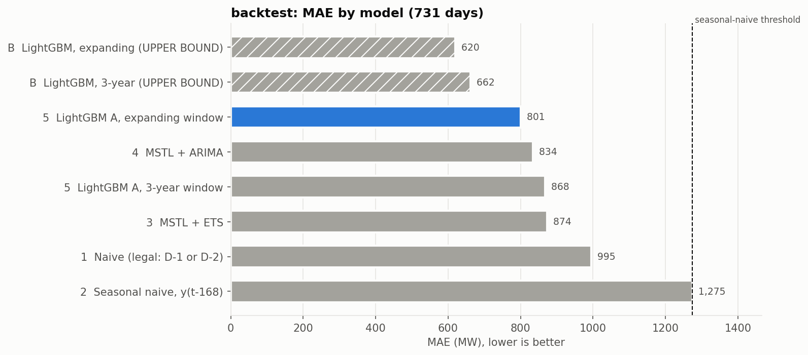
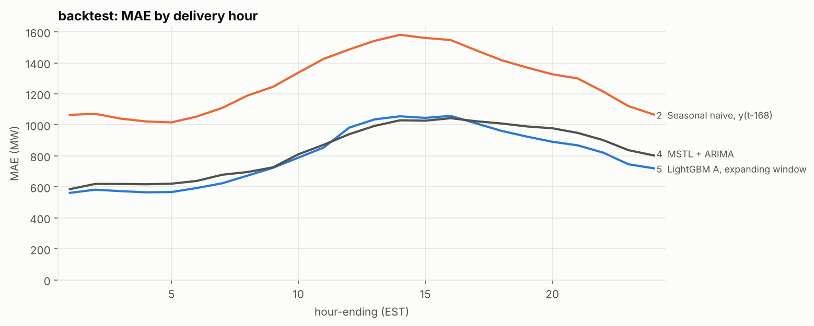
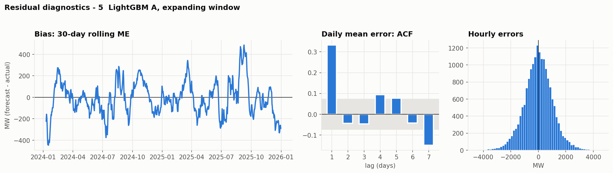
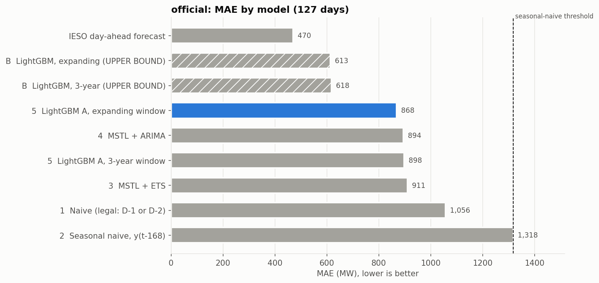
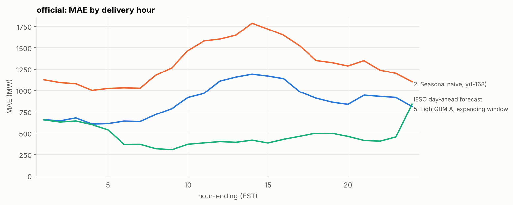
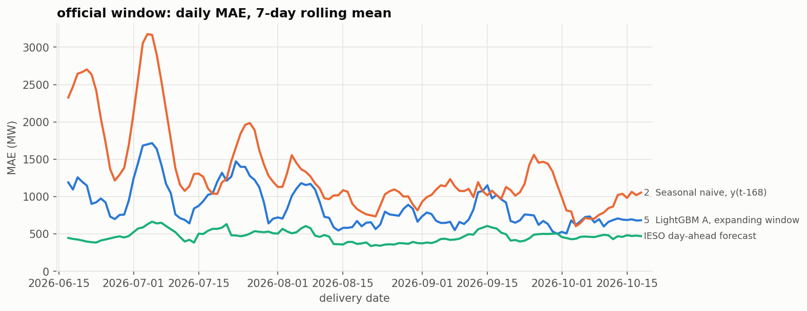

# Results - machine output

Generated 2026-10-20 05:02 by `src/evaluate/run.py`.

**Do not edit this file by hand.** Interpretation belongs in `findings.md`, which cites these numbers.

## 0. Run

- Data: 214,488 hourly rows, 2002-05-01 .. 2026-10-19
- Excluded (2003 blackout and conservation period): 6 days, 2003-08-14 .. 2003-08-19
- Forecast origin: D-1 ~12:30; data cutoff: D-1 hours beginning before 11:00 EST
- Windows: backtest 2024-01-01 .. 2025-12-31 (731 days); official 2026-06-14 .. 2026-10-18 (127 days)
- Refits: classical models at every origin on the trailing 8 weeks; LightGBM monthly, trained on days up to two days before the month
- Weather: available
- Official archive: 127 days parsed
- Python 3.13.16 · polars 2.0.0 · lightgbm 4.6.0 · statsforecast 2.1.1

## 1. Headline (generated from the numbers below, no interpretation)

- Threshold: seasonal naive scored MAE **1,275 MW** over the backtest.
- Spec rule (rung 5 must beat rung 2): LightGBM Track A **beat**, by a gap the Diebold-Mariano test separates from noise, seasonal naive - LightGBM A, expanding window MAE 801 MW (-37.2%), Diebold-Mariano p < 0.0001.
- Best Track A model overall: LightGBM A, expanding window, MAE 801 MW, ME -8 MW.
- Cost of the clock: the spec's original naive y(t-24), which reads values not yet published at 12:30, would have scored 827 MW against the legal naive's 995 MW. That gap is what the leak was worth.
- Track B (UPPER BOUND, not a forecast - uses observed temperature): best MAE 620 MW. Perfect weather knowledge would have been worth 181 MW over the best Track A model.
- Official comparison, 127 days: IESO day-ahead MAE **470 MW** (ME -177); best Track A here LightGBM A, expanding window 868 MW (+84.8% vs IESO); seasonal naive 1,318 MW.

## 2. Backtest 2024-01-01 .. 2025-12-31 - the ladder

731 delivery days, 17,542 hours, scored on the common sample (only hours every model forecast). MAE/RMSE/ME in MW; ME = forecast - actual.

| model | n_hours | MAE | RMSE | MAPE | ME |
|---|---|---|---|---|---|
| B  LightGBM, expanding (UPPER BOUND) | 17542 | 620 | 794 | 3.36 | -14 |
| B  LightGBM, 3-year (UPPER BOUND) | 17542 | 662 | 842 | 3.59 | 3.60 |
| 5  LightGBM A, expanding window | 17542 | 801 | 1,042 | 4.31 | -7.80 |
| 4  MSTL + ARIMA | 17542 | 834 | 1,090 | 4.48 | -4.10 |
| 5  LightGBM A, 3-year window | 17542 | 868 | 1,129 | 4.67 | -7.70 |
| 3  MSTL + ETS | 17542 | 874 | 1,127 | 4.73 | -3.70 |
| 1  Naive (legal: D-1 or D-2) | 17542 | 995 | 1,308 | 5.36 | -7.50 |
| 2  Seasonal naive, y(t-168) | 17542 | 1,275 | 1,666 | 6.82 | -30 |

**Is each gap real?** Diebold-Mariano test on daily MAE, Newey-West variance. Negative mean_diff = the model beat the benchmark.

| model | benchmark | n_days | mean_diff | dm_stat | p_value |
|---|---|---|---|---|---|
| naive | seasonal_naive | 731 | -279 | -5.79 | 7.2e-09 |
| mstl_ets | seasonal_naive | 731 | -401 | -7.88 | 3.2e-15 |
| mstl_arima | seasonal_naive | 731 | -441 | -9.45 | 3.5e-21 |
| lgbm_A_rolling_3y | seasonal_naive | 731 | -407 | -9.33 | 1.1e-20 |
| lgbm_A_expanding | seasonal_naive | 731 | -474 | -11 | 6.2e-26 |
| lgbm_B_rolling_3y | seasonal_naive | 731 | -612 | -12 | 2.7e-33 |
| lgbm_B_expanding | seasonal_naive | 731 | -655 | -12 | 4.1e-35 |

**MAE by delivery hour (hour-ending 1-24 EST; lead time from the last known hour is hour-ending + 13 h)**

| hour_ending | Naive (legal: D-1 or D-2) | Seasonal naive, y(t-168) | MSTL + ETS | MSTL + ARIMA | LightGBM A, 3-year window | LightGBM A, expanding window | LightGBM, 3-year (UPPER BOUND) | LightGBM, expanding (UPPER BOUND) |
|---|---|---|---|---|---|---|---|---|
| 1 | 617 | 1,065 | 655 | 585 | 629 | 561 | 497 | 463 |
| 2 | 627 | 1,072 | 691 | 619 | 646 | 582 | 519 | 478 |
| 3 | 608 | 1,040 | 701 | 619 | 621 | 573 | 514 | 483 |
| 4 | 618 | 1,022 | 710 | 617 | 613 | 565 | 510 | 475 |
| 5 | 652 | 1,016 | 712 | 621 | 619 | 567 | 506 | 480 |
| 6 | 781 | 1,054 | 720 | 639 | 643 | 593 | 532 | 499 |
| 7 | 971 | 1,109 | 743 | 678 | 710 | 623 | 606 | 537 |
| 8 | 1,003 | 1,190 | 744 | 696 | 743 | 673 | 647 | 571 |
| 9 | 966 | 1,246 | 760 | 726 | 781 | 723 | 654 | 613 |
| 10 | 953 | 1,337 | 833 | 810 | 840 | 789 | 702 | 659 |
| 11 | 965 | 1,426 | 891 | 872 | 902 | 854 | 763 | 712 |
| 12 | 1,274 | 1,486 | 943 | 940 | 1,054 | 982 | 824 | 773 |
| 13 | 1,332 | 1,542 | 997 | 994 | 1,098 | 1,035 | 837 | 780 |
| 14 | 1,344 | 1,581 | 1,029 | 1,030 | 1,129 | 1,055 | 844 | 805 |
| 15 | 1,316 | 1,561 | 1,031 | 1,027 | 1,121 | 1,045 | 806 | 764 |
| 16 | 1,292 | 1,547 | 1,054 | 1,043 | 1,129 | 1,058 | 790 | 744 |
| 17 | 1,228 | 1,481 | 1,039 | 1,024 | 1,077 | 1,010 | 764 | 714 |
| 18 | 1,166 | 1,418 | 1,034 | 1,009 | 1,040 | 961 | 703 | 682 |
| 19 | 1,170 | 1,370 | 1,015 | 990 | 1,007 | 924 | 705 | 684 |
| 20 | 1,166 | 1,327 | 1,008 | 978 | 966 | 891 | 696 | 664 |
| 21 | 1,123 | 1,300 | 977 | 948 | 950 | 868 | 682 | 632 |
| 22 | 998 | 1,215 | 941 | 902 | 884 | 821 | 627 | 594 |
| 23 | 891 | 1,121 | 881 | 837 | 826 | 746 | 588 | 543 |
| 24 | 824 | 1,067 | 866 | 803 | 795 | 720 | 578 | 527 |

**MAE by local clock hour**

| local_hour | Naive (legal: D-1 or D-2) | Seasonal naive, y(t-168) | MSTL + ETS | MSTL + ARIMA | LightGBM A, 3-year window | LightGBM A, expanding window | LightGBM, 3-year (UPPER BOUND) | LightGBM, expanding (UPPER BOUND) |
|---|---|---|---|---|---|---|---|---|
| 0 | 757 | 1,080 | 799 | 732 | 747 | 669 | 560 | 507 |
| 1 | 621 | 1,067 | 672 | 600 | 641 | 570 | 508 | 464 |
| 2 | 628 | 1,076 | 699 | 627 | 644 | 586 | 518 | 483 |
| 3 | 613 | 1,038 | 705 | 623 | 621 | 574 | 516 | 484 |
| 4 | 618 | 1,026 | 713 | 622 | 620 | 570 | 508 | 478 |
| 5 | 673 | 1,020 | 706 | 620 | 616 | 571 | 508 | 480 |
| 6 | 846 | 1,062 | 731 | 650 | 657 | 598 | 553 | 515 |
| 7 | 1,030 | 1,157 | 755 | 694 | 728 | 637 | 629 | 545 |
| 8 | 970 | 1,180 | 733 | 681 | 729 | 666 | 638 | 569 |
| 9 | 939 | 1,247 | 764 | 730 | 782 | 726 | 659 | 626 |
| 10 | 969 | 1,352 | 856 | 832 | 870 | 823 | 736 | 694 |
| 11 | 1,042 | 1,436 | 905 | 892 | 940 | 880 | 788 | 741 |
| 12 | 1,263 | 1,485 | 950 | 948 | 1,063 | 994 | 827 | 779 |
| 13 | 1,330 | 1,549 | 1,004 | 1,004 | 1,106 | 1,041 | 839 | 792 |
| 14 | 1,318 | 1,564 | 1,012 | 1,012 | 1,113 | 1,042 | 822 | 784 |
| 15 | 1,317 | 1,557 | 1,040 | 1,034 | 1,131 | 1,050 | 806 | 754 |
| 16 | 1,281 | 1,521 | 1,042 | 1,032 | 1,104 | 1,036 | 772 | 723 |
| 17 | 1,231 | 1,491 | 1,061 | 1,043 | 1,095 | 1,018 | 755 | 716 |
| 18 | 1,169 | 1,418 | 1,043 | 1,018 | 1,041 | 969 | 701 | 684 |
| 19 | 1,179 | 1,377 | 1,026 | 999 | 998 | 915 | 700 | 679 |
| 20 | 1,166 | 1,328 | 996 | 970 | 964 | 887 | 697 | 656 |
| 21 | 1,106 | 1,288 | 963 | 937 | 938 | 864 | 664 | 615 |
| 22 | 961 | 1,176 | 923 | 879 | 860 | 793 | 615 | 567 |
| 23 | 861 | 1,097 | 873 | 828 | 816 | 741 | 574 | 543 |

**MAE by season**

| season | Naive (legal: D-1 or D-2) | Seasonal naive, y(t-168) | MSTL + ETS | MSTL + ARIMA | LightGBM A, 3-year window | LightGBM A, expanding window | LightGBM, 3-year (UPPER BOUND) | LightGBM, expanding (UPPER BOUND) |
|---|---|---|---|---|---|---|---|---|
| shoulder | 899 | 957 | 810 | 721 | 740 | 702 | 621 | 593 |
| summer | 1,245 | 1,789 | 1,009 | 1,033 | 1,114 | 1,032 | 710 | 662 |
| winter | 936 | 1,394 | 865 | 859 | 875 | 765 | 697 | 632 |

**MAE by day type**

| day_type | Naive (legal: D-1 or D-2) | Seasonal naive, y(t-168) | MSTL + ETS | MSTL + ARIMA | LightGBM A, 3-year window | LightGBM A, expanding window | LightGBM, 3-year (UPPER BOUND) | LightGBM, expanding (UPPER BOUND) |
|---|---|---|---|---|---|---|---|---|
| holiday | 1,102 | 1,584 | 1,246 | 1,237 | 926 | 798 | 822 | 668 |
| weekday | 998 | 1,305 | 876 | 837 | 896 | 813 | 672 | 625 |
| weekend | 979 | 1,174 | 837 | 790 | 793 | 773 | 623 | 603 |

**MAE on extreme-temperature days (needs weather)**

| temp_band | Naive (legal: D-1 or D-2) | Seasonal naive, y(t-168) | MSTL + ETS | MSTL + ARIMA | LightGBM A, 3-year window | LightGBM A, expanding window | LightGBM, 3-year (UPPER BOUND) | LightGBM, expanding (UPPER BOUND) |
|---|---|---|---|---|---|---|---|---|
| extreme cold (bottom 5%) | 1,079 | 1,379 | 1,036 | 1,018 | 1,004 | 885 | 820 | 745 |
| extreme hot (top 5%) | 1,413 | 2,460 | 1,074 | 1,166 | 1,247 | 1,127 | 746 | 698 |
| normal | 967 | 1,202 | 853 | 804 | 838 | 778 | 648 | 608 |

**Bias (ME) by season** - positive = over-forecast

| season | Naive (legal: D-1 or D-2) | Seasonal naive, y(t-168) | MSTL + ETS | MSTL + ARIMA | LightGBM A, 3-year window | LightGBM A, expanding window | LightGBM, 3-year (UPPER BOUND) | LightGBM, expanding (UPPER BOUND) |
|---|---|---|---|---|---|---|---|---|
| shoulder | 13 | 80 | 3.40 | 9.20 | -17 | 5.90 | -53 | -18 |
| summer | -22 | -152 | -14 | -41 | 34 | 14 | 103 | 27 |
| winter | -34 | -130 | -7.40 | 6.40 | -31 | -58 | 16 | -47 |

## 3. What the leaky naive would have been worth

Same hours, same days. `naive_leaky` is the spec's original y(t-24); it uses values that are not published until after the 12:30 origin for every delivery hour from 11:00 EST on.

| model | n_hours | MAE | RMSE | MAPE | ME |
|---|---|---|---|---|---|
| x  Naive y(t-24) - LEAKS, diagnostic | 17541 | 827 | 1,083 | 4.49 | -4.80 |
| 1  Naive (legal: D-1 or D-2) | 17542 | 995 | 1,308 | 5.36 | -7.50 |

## Residual diagnostics - 5  LightGBM A, expanding window (backtest)

Autocorrelation of the daily mean error, lags 1-7 days (|value| above 0.07 is outside the 95% noise band):

| lag_days | acf |
|---|---|
| 1 | 0.332 |
| 2 | -0.044 |
| 3 | -0.046 |
| 4 | 0.094 |
| 5 | 0.078 |
| 6 | -0.042 |
| 7 | -0.148 |

Hourly error quantiles (MW): 5% -1,744 · 25% -640 · median -2 · 75% 639 · 95% 1,674

Monthly bias:

| month | ME | MAE |
|---|---|---|
| 2024-01 | -99 | 732 |
| 2024-02 | 67 | 822 |
| 2024-03 | 20 | 826 |
| 2024-04 | 13 | 644 |
| 2024-05 | 6.00 | 775 |
| 2024-06 | -206 | 1,098 |
| 2024-07 | -93 | 786 |
| 2024-08 | 44 | 1,052 |
| 2024-09 | 68 | 760 |
| 2024-10 | 194 | 542 |
| 2024-11 | -98 | 584 |
| 2024-12 | 63 | 732 |
| 2025-01 | -126 | 734 |
| 2025-02 | 52 | 758 |
| 2025-03 | 80 | 820 |
| 2025-04 | -89 | 795 |
| 2025-05 | 46 | 705 |
| 2025-06 | -223 | 1,005 |
| 2025-07 | 87 | 1,271 |
| 2025-08 | 459 | 979 |
| 2025-09 | -176 | 634 |
| 2025-10 | -91 | 615 |
| 2025-11 | 92 | 727 |
| 2025-12 | -284 | 816 |

## Feature importance (gain %, last monthly refit of the backtest)

| feature | lgbm_A_rolling_3y | lgbm_A_expanding | lgbm_B_rolling_3y | lgbm_B_expanding |
|---|---|---|---|---|
| temp_day_mean_delta_7d |  |  | 9.10 | 9.70 |
| temp_day_mean |  |  | 6.30 | 6.20 |
| temp_delta_168 |  |  | 5.10 | 6.40 |
| temp |  |  | 3.70 | 3.50 |
| temp_day_max |  |  | 3.60 | 3.70 |
| temp_day_min |  |  | 2.70 | 1.80 |
| cdd |  |  | 2.20 | 2.80 |
| hdd |  |  | 1.10 | 1.20 |
| rel_d48 | 30 | 19 | 27 | 15 |
| rel_origin_last_wow | 18 | 31 | 11 | 22 |
| rel_d336 | 10 | 9.20 | 7.10 | 6.20 |
| doy_cos | 7.90 | 5.10 | 2.40 | 2.30 |
| rel_origin_24_168 | 6.70 | 6.60 | 2.70 | 1.30 |
| rel_d24 | 6.30 | 6.30 | 4.90 | 4.60 |
| doy_sin | 5.60 | 5.00 | 2.50 | 2.20 |
| origin_wow_ratio | 5.50 | 4.80 | 2.40 | 2.90 |
| weekday | 4.70 | 6.00 | 2.30 | 3.10 |
| month | 1.60 | 1.00 | 1.30 | 1.00 |
| local_hour | 1.40 | 1.60 | 0.9 | 1.20 |
| h | 1.20 | 0.9 | 0.8 | 0.6 |
| is_stat_holiday | 0.5 | 1.80 | 0.5 | 1.60 |
| is_weekend | 0.2 | 0.3 | 0.3 | 0.4 |
| is_day_after_holiday | 0.2 | 0.3 | 0 | 0.2 |
| is_day_before_holiday | 0.1 | 0.4 | 0.1 | 0.4 |
| is_observed_holiday | 0 | 0.2 | 0 | 0.1 |

## 4. Official comparison - against IESO's own day-ahead forecast

127 delivery days, 3,048 hours, scored on the common sample (only hours every model forecast). MAE/RMSE/ME in MW; ME = forecast - actual.

| model | n_hours | MAE | RMSE | MAPE | ME |
|---|---|---|---|---|---|
| IESO day-ahead forecast | 3048 | 470 | 608 | 2.46 | -177 |
| B  LightGBM, expanding (UPPER BOUND) | 3048 | 613 | 775 | 3.21 | 32 |
| B  LightGBM, 3-year (UPPER BOUND) | 3048 | 618 | 789 | 3.24 | 66 |
| 5  LightGBM A, expanding window | 3048 | 868 | 1,146 | 4.46 | 56 |
| 4  MSTL + ARIMA | 3048 | 894 | 1,141 | 4.63 | 42 |
| 5  LightGBM A, 3-year window | 3048 | 898 | 1,170 | 4.62 | 124 |
| 3  MSTL + ETS | 3048 | 911 | 1,148 | 4.73 | 27 |
| 1  Naive (legal: D-1 or D-2) | 3048 | 1,056 | 1,379 | 5.43 | 46 |
| 2  Seasonal naive, y(t-168) | 3048 | 1,318 | 1,696 | 6.79 | 139 |

**Is each gap real?** Diebold-Mariano test on daily MAE, Newey-West variance. Negative mean_diff = the model beat the benchmark.

| model | benchmark | n_days | mean_diff | dm_stat | p_value |
|---|---|---|---|---|---|
| naive | seasonal_naive | 127 | -262 | -2.16 | 0.031 |
| mstl_ets | seasonal_naive | 127 | -407 | -3.38 | 0.00073 |
| mstl_arima | seasonal_naive | 127 | -424 | -3.63 | 0.00028 |
| lgbm_A_rolling_3y | seasonal_naive | 127 | -420 | -4.91 | 8.9e-07 |
| lgbm_A_expanding | seasonal_naive | 127 | -450 | -5.10 | 3.4e-07 |
| lgbm_B_rolling_3y | seasonal_naive | 127 | -700 | -5.80 | 6.7e-09 |
| lgbm_B_expanding | seasonal_naive | 127 | -705 | -6.01 | 1.9e-09 |
| ieso_official | seasonal_naive | 127 | -848 | -7.16 | 7.9e-13 |
| lgbm_A_expanding | ieso_official | 127 | 398 | 7.24 | 4.6e-13 |

**MAE by delivery hour (hour-ending 1-24 EST; lead time from the last known hour is hour-ending + 13 h)**

| hour_ending | Naive (legal: D-1 or D-2) | Seasonal naive, y(t-168) | MSTL + ETS | MSTL + ARIMA | LightGBM A, 3-year window | LightGBM A, expanding window | LightGBM, 3-year (UPPER BOUND) | LightGBM, expanding (UPPER BOUND) | IESO day-ahead forecast |
|---|---|---|---|---|---|---|---|---|---|
| 1 | 704 | 1,125 | 658 | 627 | 653 | 658 | 524 | 495 | 656 |
| 2 | 692 | 1,092 | 676 | 631 | 648 | 644 | 518 | 509 | 631 |
| 3 | 708 | 1,079 | 730 | 686 | 658 | 678 | 546 | 533 | 643 |
| 4 | 664 | 1,002 | 728 | 663 | 628 | 608 | 506 | 494 | 602 |
| 5 | 705 | 1,024 | 719 | 651 | 618 | 613 | 520 | 510 | 541 |
| 6 | 833 | 1,032 | 715 | 667 | 652 | 642 | 534 | 510 | 370 |
| 7 | 954 | 1,027 | 735 | 688 | 702 | 637 | 576 | 544 | 371 |
| 8 | 969 | 1,178 | 751 | 733 | 746 | 719 | 586 | 591 | 320 |
| 9 | 948 | 1,265 | 793 | 794 | 775 | 788 | 602 | 619 | 309 |
| 10 | 1,033 | 1,466 | 914 | 923 | 913 | 918 | 681 | 724 | 372 |
| 11 | 985 | 1,579 | 935 | 960 | 960 | 965 | 721 | 755 | 387 |
| 12 | 1,436 | 1,601 | 1,003 | 1,035 | 1,114 | 1,109 | 745 | 785 | 402 |
| 13 | 1,450 | 1,646 | 1,076 | 1,105 | 1,162 | 1,155 | 768 | 762 | 394 |
| 14 | 1,548 | 1,786 | 1,140 | 1,169 | 1,213 | 1,189 | 772 | 764 | 419 |
| 15 | 1,509 | 1,717 | 1,159 | 1,174 | 1,188 | 1,167 | 743 | 716 | 386 |
| 16 | 1,435 | 1,644 | 1,116 | 1,132 | 1,140 | 1,136 | 700 | 718 | 429 |
| 17 | 1,277 | 1,520 | 1,057 | 1,061 | 1,048 | 983 | 698 | 661 | 464 |
| 18 | 1,140 | 1,349 | 1,006 | 977 | 992 | 911 | 647 | 616 | 500 |
| 19 | 1,108 | 1,325 | 1,018 | 988 | 985 | 864 | 607 | 584 | 498 |
| 20 | 1,072 | 1,286 | 1,000 | 971 | 948 | 838 | 562 | 530 | 462 |
| 21 | 1,130 | 1,348 | 1,030 | 1,015 | 1,022 | 945 | 637 | 616 | 415 |
| 22 | 1,054 | 1,237 | 1,018 | 996 | 970 | 931 | 589 | 600 | 407 |
| 23 | 1,042 | 1,199 | 958 | 922 | 953 | 918 | 556 | 546 | 456 |
| 24 | 953 | 1,102 | 921 | 880 | 854 | 813 | 491 | 530 | 840 |

**MAE by local clock hour**

| local_hour | Naive (legal: D-1 or D-2) | Seasonal naive, y(t-168) | MSTL + ETS | MSTL + ARIMA | LightGBM A, 3-year window | LightGBM A, expanding window | LightGBM, 3-year (UPPER BOUND) | LightGBM, expanding (UPPER BOUND) | IESO day-ahead forecast |
|---|---|---|---|---|---|---|---|---|---|
| 0 | 953 | 1,102 | 921 | 880 | 854 | 813 | 491 | 530 | 840 |
| 1 | 704 | 1,125 | 658 | 627 | 653 | 658 | 524 | 495 | 656 |
| 2 | 692 | 1,092 | 676 | 631 | 648 | 644 | 518 | 509 | 631 |
| 3 | 708 | 1,079 | 730 | 686 | 658 | 678 | 546 | 533 | 643 |
| 4 | 664 | 1,002 | 728 | 663 | 628 | 608 | 506 | 494 | 602 |
| 5 | 705 | 1,024 | 719 | 651 | 618 | 613 | 520 | 510 | 541 |
| 6 | 833 | 1,032 | 715 | 667 | 652 | 642 | 534 | 510 | 370 |
| 7 | 954 | 1,027 | 735 | 688 | 702 | 637 | 576 | 544 | 371 |
| 8 | 969 | 1,178 | 751 | 733 | 746 | 719 | 586 | 591 | 320 |
| 9 | 948 | 1,265 | 793 | 794 | 775 | 788 | 602 | 619 | 309 |
| 10 | 1,033 | 1,466 | 914 | 923 | 913 | 918 | 681 | 724 | 372 |
| 11 | 985 | 1,579 | 935 | 960 | 960 | 965 | 721 | 755 | 387 |
| 12 | 1,436 | 1,601 | 1,003 | 1,035 | 1,114 | 1,109 | 745 | 785 | 402 |
| 13 | 1,450 | 1,646 | 1,076 | 1,105 | 1,162 | 1,155 | 768 | 762 | 394 |
| 14 | 1,548 | 1,786 | 1,140 | 1,169 | 1,213 | 1,189 | 772 | 764 | 419 |
| 15 | 1,509 | 1,717 | 1,159 | 1,174 | 1,188 | 1,167 | 743 | 716 | 386 |
| 16 | 1,435 | 1,644 | 1,116 | 1,132 | 1,140 | 1,136 | 700 | 718 | 429 |
| 17 | 1,277 | 1,520 | 1,057 | 1,061 | 1,048 | 983 | 698 | 661 | 464 |
| 18 | 1,140 | 1,349 | 1,006 | 977 | 992 | 911 | 647 | 616 | 500 |
| 19 | 1,108 | 1,325 | 1,018 | 988 | 985 | 864 | 607 | 584 | 498 |
| 20 | 1,072 | 1,286 | 1,000 | 971 | 948 | 838 | 562 | 530 | 462 |
| 21 | 1,130 | 1,348 | 1,030 | 1,015 | 1,022 | 945 | 637 | 616 | 415 |
| 22 | 1,054 | 1,237 | 1,018 | 996 | 970 | 931 | 589 | 600 | 407 |
| 23 | 1,042 | 1,199 | 958 | 922 | 953 | 918 | 556 | 546 | 456 |

**MAE by season**

| season | Naive (legal: D-1 or D-2) | Seasonal naive, y(t-168) | MSTL + ETS | MSTL + ARIMA | LightGBM A, 3-year window | LightGBM A, expanding window | LightGBM, 3-year (UPPER BOUND) | LightGBM, expanding (UPPER BOUND) | IESO day-ahead forecast |
|---|---|---|---|---|---|---|---|---|---|
| shoulder | 965 | 1,049 | 847 | 806 | 770 | 719 | 668 | 639 | 472 |
| summer | 1,112 | 1,481 | 949 | 947 | 975 | 958 | 587 | 597 | 468 |

**MAE by day type**

| day_type | Naive (legal: D-1 or D-2) | Seasonal naive, y(t-168) | MSTL + ETS | MSTL + ARIMA | LightGBM A, 3-year window | LightGBM A, expanding window | LightGBM, 3-year (UPPER BOUND) | LightGBM, expanding (UPPER BOUND) | IESO day-ahead forecast |
|---|---|---|---|---|---|---|---|---|---|
| holiday | 1,077 | 2,295 | 844 | 974 | 1,391 | 1,512 | 918 | 1,090 | 488 |
| weekday | 1,004 | 1,366 | 920 | 907 | 946 | 893 | 597 | 578 | 474 |
| weekend | 1,177 | 1,124 | 893 | 856 | 743 | 757 | 642 | 657 | 458 |

**MAE on extreme-temperature days (needs weather)**

| temp_band | Naive (legal: D-1 or D-2) | Seasonal naive, y(t-168) | MSTL + ETS | MSTL + ARIMA | LightGBM A, 3-year window | LightGBM A, expanding window | LightGBM, 3-year (UPPER BOUND) | LightGBM, expanding (UPPER BOUND) | IESO day-ahead forecast |
|---|---|---|---|---|---|---|---|---|---|
| extreme cold (bottom 5%) | 811 | 918 | 783 | 687 | 710 | 667 | 689 | 637 | 485 |
| extreme hot (top 5%) | 1,435 | 2,915 | 970 | 1,028 | 1,699 | 1,942 | 652 | 739 | 757 |
| normal | 1,048 | 1,244 | 915 | 898 | 860 | 814 | 611 | 604 | 451 |

**Bias (ME) by season** - positive = over-forecast

| season | Naive (legal: D-1 or D-2) | Seasonal naive, y(t-168) | MSTL + ETS | MSTL + ARIMA | LightGBM A, 3-year window | LightGBM A, expanding window | LightGBM, 3-year (UPPER BOUND) | LightGBM, expanding (UPPER BOUND) | IESO day-ahead forecast |
|---|---|---|---|---|---|---|---|---|---|
| shoulder | 74 | 137 | 56 | 71 | 19 | -48 | -46 | -50 | -312 |
| summer | 30 | 140 | 9.60 | 25 | 188 | 120 | 134 | 81 | -95 |

## Weather coverage (fraction of hours with a value, by city and year)

| year | toronto | ottawa | london | temp |
|---|---|---|---|---|
| 2003 | 1.00 | 1.00 | 0.999 | 1.00 |
| 2004 | 1.00 | 1.00 | 1.00 | 1.00 |
| 2005 | 1.00 | 1.00 | 1.00 | 1.00 |
| 2006 | 1.00 | 1.00 | 1.00 | 1.00 |
| 2007 | 1.00 | 1.00 | 1.00 | 1.00 |
| 2008 | 1.00 | 1.00 | 1.00 | 1.00 |
| 2009 | 1.00 | 1.00 | 1.00 | 1.00 |
| 2010 | 1.00 | 1.00 | 1.00 | 1.00 |
| 2011 | 1.00 | 1.00 | 1.00 | 1.00 |
| 2012 | 1.00 | 0.993 | 0.995 | 1.00 |
| 2013 | 0.999 | 0.998 | 0.998 | 0.999 |
| 2014 | 1.00 | 1.00 | 0.999 | 1.00 |
| 2015 | 0.999 | 0.998 | 0.998 | 1.00 |
| 2016 | 1.00 | 1.00 | 1.00 | 1.00 |
| 2017 | 1.00 | 1.00 | 0.999 | 1.00 |
| 2018 | 1.00 | 1.00 | 1.00 | 1.00 |
| 2019 | 1.00 | 1.00 | 1.00 | 1.00 |
| 2020 | 1.00 | 0.999 | 1.00 | 1.00 |
| 2021 | 1.00 | 1.00 | 0.999 | 1.00 |
| 2022 | 0.999 | 0.999 | 0.999 | 1.00 |
| 2023 | 1.00 | 1.00 | 0.999 | 1.00 |
| 2024 | 1.00 | 1.00 | 0.998 | 1.00 |
| 2025 | 1.00 | 1.00 | 0.998 | 1.00 |
| 2026 | 1.00 | 1.00 | 0.999 | 1.00 |

## EDA appendix (Milestone 2, sections 0-7)

**0. Blackout exclusion window** (weekday-corrected):

| local_date | weekday | mean_mw | rel | weekday_factor | rel_expected | deficit | suppressed |
|---|---|---|---|---|---|---|---|
| 2003-08-14 | 4 | 14,668 | 0.813 | 1.02 | 1.03 | 0.213 | True |
| 2003-08-15 | 5 | 12,108 | 0.671 | 1.01 | 1.01 | 0.336 | True |
| 2003-08-16 | 6 | 15,335 | 0.85 | 0.932 | 0.95 | 0.105 | True |
| 2003-08-17 | 7 | 14,207 | 0.788 | 0.927 | 0.961 | 0.181 | True |
| 2003-08-18 | 1 | 15,857 | 0.879 | 1.03 | 1.09 | 0.193 | True |
| 2003-08-19 | 2 | 16,572 | 0.919 | 1.05 | 1.07 | 0.144 | True |
| 2003-08-20 | 3 | 17,038 | 0.945 | 1.03 | 1.03 | 0.0856 | False |
| 2003-08-21 | 4 | 18,000 | 0.998 | 1.02 | 1.02 | 0.0212 | False |
| 2003-08-22 | 5 | 17,581 | 0.975 | 1.01 | 0.998 | 0.0233 | False |
| 2003-08-23 | 6 | 15,674 | 0.869 | 0.932 | 0.927 | 0.0626 | False |
| 2003-08-24 | 7 | 15,072 | 0.836 | 0.927 | 0.918 | 0.0893 | False |
| 2003-08-25 | 1 | 18,854 | 1.05 | 1.03 | 1.05 | 0.0016 | False |
| 2003-08-26 | 2 | 19,681 | 1.09 | 1.05 | 1.08 | -0.0124 | False |
| 2003-08-27 | 3 | 19,393 | 1.08 | 1.03 | 1.07 | -0.0026 | False |
| 2003-08-28 | 4 | 17,845 | 0.99 | 1.02 | 1.05 | 0.055 | False |
| 2003-08-29 | 5 | 18,720 | 1.04 | 1.01 | 1.02 | -0.0202 | False |

**1. DST falsification test** - mean |shift| in morning-ramp hour across transitions vs a control three weeks earlier:

| kind | n | mean_abs_shift | mean_abs_control |
|---|---|---|---|
| spring forward | 24 | 0.28 | 0.201 |
| fall back | 24 | 0.159 | 0.268 |

**2. Daily shape** - peak and trough of the mean profile:

| season | is_weekend | peak_local_hour | peak_mean_mw | trough_local_hour | trough_mean_mw |
|---|---|---|---|---|---|
| shoulder | False | 19 | 19,144 | 3 | 15,015 |
| shoulder | True | 19 | 17,695 | 4 | 14,592 |
| summer | False | 17 | 21,496 | 4 | 15,640 |
| summer | True | 17 | 19,730 | 5 | 14,883 |
| winter | False | 18 | 22,071 | 3 | 17,123 |
| winter | True | 18 | 20,869 | 3 | 16,738 |

**3. Weekly shape** - weekend vs weekday mean:

| season | weekday_mw | weekend_mw | weekend_drop_pct |
|---|---|---|---|
| shoulder | 17,530 | 16,257 | -7.30 |
| winter | 19,767 | 18,620 | -5.80 |
| summer | 19,003 | 17,480 | -8.00 |

**4. Annual peaks** - count by season, then every year:

| peak_season | years |
|---|---|
| summer | 18 |
| winter | 6 |
| shoulder | 1 |

| year | peak_ts_local | peak_mw | peak_season | mean_mw |
|---|---|---|---|---|
| 2002 | 2002-08-01 16:00:00 | 25,496 | summer | 17,819 |
| 2003 | 2003-06-26 15:00:00 | 25,098 | summer | 18,089 |
| 2004 | 2004-01-26 17:00:00 | 25,446 | winter | 18,548 |
| 2005 | 2005-06-27 17:00:00 | 26,612 | summer | 19,081 |
| 2006 | 2006-08-01 14:00:00 | 27,375 | summer | 18,544 |
| 2007 | 2007-06-26 16:00:00 | 26,658 | summer | 18,778 |
| 2008 | 2008-07-08 16:00:00 | 27,477 | summer | 19,453 |
| 2009 | 2009-08-18 17:00:00 | 25,815 | summer | 17,614 |
| 2010 | 2010-07-07 16:00:00 | 27,735 | summer | 17,963 |
| 2011 | 2011-07-21 16:00:00 | 27,999 | summer | 17,616 |
| 2012 | 2012-07-17 16:00:00 | 26,815 | summer | 17,749 |
| 2013 | 2013-07-17 14:00:00 | 26,842 | summer | 18,099 |
| 2014 | 2014-01-07 18:00:00 | 25,980 | winter | 18,068 |
| 2015 | 2015-01-07 17:00:00 | 26,087 | winter | 18,154 |
| 2016 | 2016-09-07 17:00:00 | 25,093 | shoulder | 18,007 |
| 2017 | 2017-12-31 17:00:00 | 23,504 | winter | 17,189 |
| 2018 | 2018-01-03 17:00:00 | 24,490 | winter | 17,766 |
| 2019 | 2019-07-29 17:00:00 | 24,561 | summer | 17,632 |
| 2020 | 2020-07-27 15:00:00 | 26,192 | summer | 17,324 |
| 2021 | 2021-08-24 16:00:00 | 24,609 | summer | 17,193 |
| 2022 | 2022-07-20 16:00:00 | 24,702 | summer | 17,648 |
| 2023 | 2023-02-03 17:00:00 | 24,888 | winter | 17,443 |
| 2024 | 2024-07-31 17:00:00 | 25,446 | summer | 18,022 |
| 2025 | 2025-06-24 15:00:00 | 26,714 | summer | 18,896 |
| 2026 | 2026-07-02 17:00:00 | 27,678 | summer | 19,428 |

**5. Level bias by training-window length** (estimate = mean of previous W years; W=99 means all):

| season | window_years | n_eval_years | mean_bias_mw | mean_abs_bias_mw | worst_abs_mw |
|---|---|---|---|---|---|
| all | 1 | 13 | -88 | 361 | 874 |
| all | 2 | 13 | -104 | 359 | 1,164 |
| all | 3 | 13 | -96 | 344 | 1,192 |
| all | 5 | 13 | -55 | 372 | 1,370 |
| all | 10 | 13 | 154 | 406 | 1,258 |
| all | 99 | 13 | 342 | 486 | 1,050 |
| summer | 1 | 13 | -50 | 674 | 1,532 |
| summer | 2 | 13 | -66 | 568 | 1,424 |
| summer | 3 | 13 | -39 | 543 | 1,302 |
| summer | 5 | 13 | -12 | 522 | 1,279 |
| summer | 10 | 13 | 160 | 561 | 1,347 |
| summer | 99 | 13 | 326 | 551 | 1,378 |
| winter | 1 | 13 | -200 | 582 | 1,296 |
| winter | 2 | 13 | -231 | 602 | 1,684 |
| winter | 3 | 13 | -222 | 608 | 1,624 |
| winter | 5 | 13 | -171 | 558 | 1,942 |
| winter | 10 | 13 | 48 | 532 | 1,860 |
| winter | 99 | 13 | 243 | 575 | 1,534 |

**6. How far the series moves** (NOT a baseline score - no origin, no split):

| lag | season | median_mw | mean_mw | p90_mw | n |
|---|---|---|---|---|---|
| abs_d168 | shoulder | 674 | 900 | 1,939 | 106966 |
| abs_d168 | summer | 1,096 | 1,457 | 3,255 | 54888 |
| abs_d168 | winter | 922 | 1,164 | 2,494 | 51984 |
| abs_d24 | shoulder | 556 | 779 | 1,795 | 107254 |
| abs_d24 | summer | 761 | 1,021 | 2,290 | 55032 |
| abs_d24 | winter | 627 | 834 | 1,832 | 51984 |

**7. Holiday effect** - daily mean vs same weekday, same month and year:

| holiday | n_years | mean_delta_pct | min_delta_pct | max_delta_pct |
|---|---|---|---|---|
| New Year's Day | 24 | -13 | -26 | 0.6 |
| Christmas Day | 24 | -11 | -24 | 7.50 |
| Boxing Day | 20 | -9.50 | -18 | 1.30 |
| New Year's Day (observed) | 7 | -8.70 | -11 | -5.40 |
| Boxing Day; Christmas Day (observed) | 4 | -8.40 | -18 | 5.40 |
| Thanksgiving Day | 25 | -8.20 | -14 | 1.90 |
| Good Friday | 24 | -7.70 | -19 | 1.60 |
| Canada Day | 25 | -7.50 | -26 | 14 |
| Victoria Day | 25 | -7.30 | -18 | 8.90 |
| Boxing Day (observed) | 6 | -4.70 | -10 | 0.9 |
| Family Day | 19 | -4.60 | -14 | 6.90 |
| Christmas Day (observed) | 3 | -4.40 | -6.50 | -0.7 |
| Labor Day | 25 | -2.90 | -16 | 25 |

---
Run time 32.6 min.
