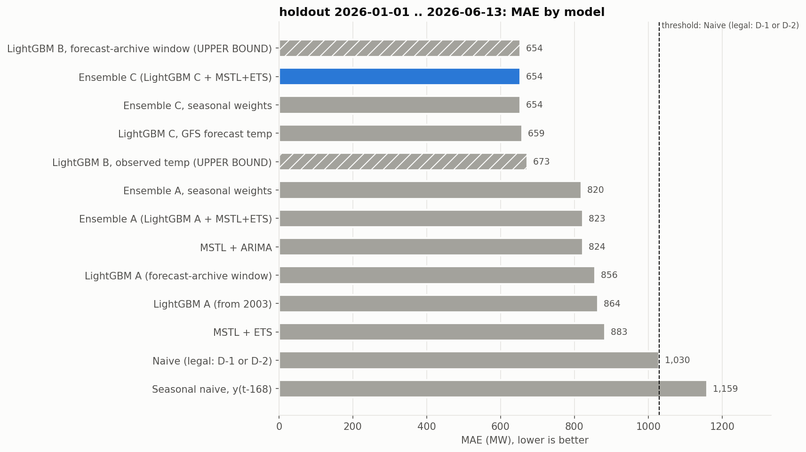
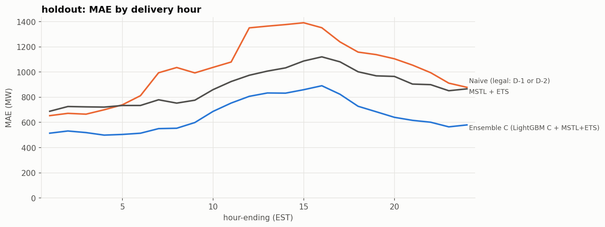
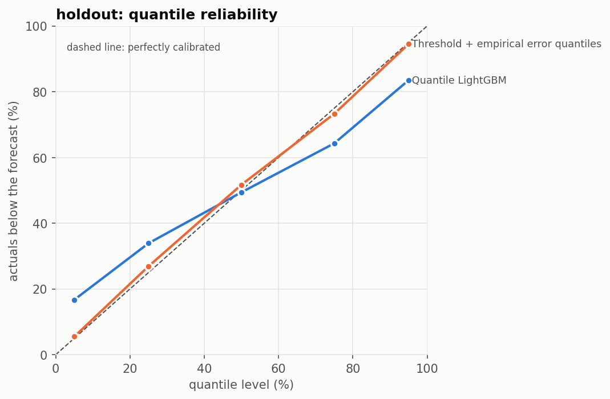
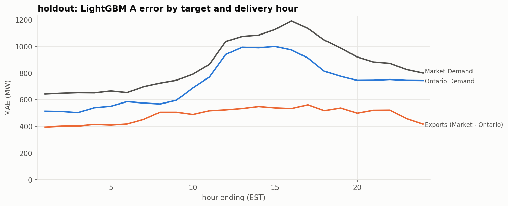

# v2 results - machine output

Generated 2026-10-22 02:54 by `src/evaluate/run_v2.py` under `docs/spec-v2.md`.

**Do not edit this file by hand.** Interpretation belongs in `reports/findings.md`.

## 0. Run

- Code: commit 2c46783; freeze date **2026-10-20** (git: last commit touching src/ (plots excluded)); prospective window = delivery days after 2026-10-20
- Windows: dev 2023-01-01 .. 2023-12-31 (365 days); holdout 2026-01-01 .. 2026-06-13 (164 days); seen_backtest 2024-01-01 .. 2025-12-31 (731 days); official archive 2026-06-14 .. 2026-10-20 (129 days)
- Threshold (chosen on dev): **Naive (legal: D-1 or D-2)** - dev MAE Naive (legal: D-1 or D-2) 974, Seasonal naive, y(t-168) 1,075
- Ensemble weights (fitted on dev, w = LightGBM share): ens_A_global: {'all': 0.7}; ens_A_seasonal: {'other': 0.7, 'summer': 0.6}; ens_C_global: {'all': 0.8}; ens_C_seasonal: {'other': 0.8, 'summer': 0.8}
- Observed weather: available; complete through **2026-10-20** (Track B is not scored after that day)
- Forecast weather: available - model ncep_gfs_global, rule day1_day2, verification pass
- Forecast archive first full month: 2021-04 (Track C and its controls train from 2021-04-01)
- Verification of the forecast-run mapping: **pass** - day1 100.0% of 120 values, day2 100.0% of 120 at the expected lead
- Quantile model: track C, q = (0.05, 0.25, 0.5, 0.75, 0.95)
- Best operational model on holdout (used as 'best' in later windows): Ensemble C (LightGBM C + MSTL+ETS)
- Python 3.13.16 · polars 2.0.0 · lightgbm 4.6.0 · statsforecast 2.1.1

Matching leads found in verification (hours between run start and valid time; expected 24-29 for day1, 48-53 for day2):

| series | leads | values |
|---|---|---|
| day1 | 10,16,28 | 1 |
| day1 | 10,28 | 1 |
| day1 | 11,17,29 | 2 |
| day1 | 12,18,24 | 1 |
| day1 | 12,24 | 1 |
| day1 | 13,25 | 1 |
| day1 | 14,26 | 1 |
| day1 | 16,28 | 2 |
| day1 | 18,24 | 1 |
| day1 | 18,24,36 | 1 |
| day1 | 19,25 | 3 |
| day1 | 20,26 | 1 |
| day1 | 21,27 | 4 |
| day1 | 22,28 | 2 |
| day1 | 23,29 | 2 |
| day1 | 23,29,35 | 1 |
| day1 | 23,29,41 | 1 |
| day1 | 24 | 10 |
| day1 | 24,30 | 3 |
| day1 | 24,30,36 | 2 |
| day1 | 25 | 8 |
| day1 | 25,31 | 4 |
| day1 | 25,31,37 | 3 |
| day1 | 25,37 | 1 |
| day1 | 26 | 13 |
| day1 | 26,32 | 1 |
| day1 | 26,38 | 1 |
| day1 | 26,44 | 2 |
| day1 | 27 | 8 |
| day1 | 27,33 | 2 |
| day1 | 27,33,45 | 1 |
| day1 | 27,39 | 1 |
| day1 | 27,45 | 2 |
| day1 | 28 | 9 |
| day1 | 28,34,40 | 1 |
| day1 | 28,34,46 | 1 |
| day1 | 28,40 | 2 |
| day1 | 28,40,46 | 1 |
| day1 | 29 | 10 |
| day1 | 29,35 | 2 |
| day1 | 29,35,41 | 1 |
| day1 | 29,41,47 | 1 |
| day1 | 6,12,24 | 1 |
| day1 | 8,26 | 1 |
| day1 | 9,27 | 2 |
| day2 | 34,40,46,52 | 1 |
| day2 | 34,52 | 1 |
| day2 | 36,48 | 2 |
| day2 | 37,49 | 2 |
| day2 | 38,44,50 | 1 |
| day2 | 39,45,51 | 1 |
| day2 | 39,51 | 1 |
| day2 | 40,46,52 | 1 |
| day2 | 40,52 | 1 |
| day2 | 41,53 | 1 |
| day2 | 42,48 | 5 |
| day2 | 42,48,54 | 1 |
| day2 | 43,49 | 1 |
| day2 | 43,49,55 | 1 |
| day2 | 44,50 | 2 |
_(81 rows, first 60 shown)_

## 1. Headline (generated, no interpretation) - clean holdout unless stated

- Threshold (Naive (legal: D-1 or D-2), chosen on dev): holdout MAE **1,030 MW**.
- Best operational model: **Ensemble C (LightGBM C + MSTL+ETS)**, MAE 654 MW, ME -7 MW (-36.5% vs threshold; Holm-adjusted p < 0.0001).
- Track C: forecast weather worth **197 MW** (A 856 -> C 659, same training window; Holm p < 0.0001). Forecast error costs 5 MW against perfect weather (B 654); C recovers 98% of the weather gap.
- Ensemble A (w = 0.7): MAE 823 vs LightGBM A 864 (Holm p 0.00041) and MSTL+ETS 883 (Holm p 0.11).
- Probabilistic: pinball 226 vs baseline 320; 90% interval covers 66.8% (baseline 89.0%), 50% covers 30.4% (baseline 46.4%).
- Exports hypothesis (spec-v2 section 5): **not supported** - export share of error 42% at night vs 39% by day; night MAE exports 406 vs Ontario 561.
- Prospective: no delivery days after the freeze date (2026-10-20) yet. Rerun the notebook to add them.

## 2. Holdout 2026-01-01 .. 2026-06-13 - clean

164 days, 3,936 hours, common sample. Track B rows are upper bounds, not forecasts.

| model | n_hours | MAE | RMSE | MAPE | ME |
|---|---|---|---|---|---|
| Naive (legal: D-1 or D-2) | 3936 | 1,030 | 1,322 | 5.32 | 6.70 |
| Seasonal naive, y(t-168) | 3936 | 1,159 | 1,498 | 5.92 | 2.40 |
| MSTL + ETS | 3936 | 883 | 1,138 | 4.55 | -3.10 |
| MSTL + ARIMA | 3936 | 824 | 1,078 | 4.22 | -7.60 |
| LightGBM A (from 2003) | 3936 | 864 | 1,118 | 4.42 | -25 |
| Ensemble A (LightGBM A + MSTL+ETS) | 3936 | 823 | 1,068 | 4.22 | -18 |
| Ensemble A, seasonal weights | 3936 | 820 | 1,064 | 4.20 | -15 |
| LightGBM C, GFS forecast temp | 3936 | 659 | 846 | 3.38 | -8.00 |
| Ensemble C (LightGBM C + MSTL+ETS) | 3936 | 654 | 843 | 3.36 | -7.00 |
| Ensemble C, seasonal weights | 3936 | 654 | 843 | 3.36 | -7.00 |
| LightGBM A (forecast-archive window) | 3936 | 856 | 1,112 | 4.38 | -52 |
| LightGBM B, forecast-archive window (UPPER BOUND) | 3936 | 654 | 832 | 3.36 | 26 |
| LightGBM B, observed temp (UPPER BOUND) | 3936 | 673 | 853 | 3.46 | 21 |

**Pre-declared Diebold-Mariano family** (negative mean_diff = model better; conclusions use p_holm):

| model | benchmark | reason | n_days | mean_diff | dm_stat | p_value | p_holm |
|---|---|---|---|---|---|---|---|
| mstl_ets | naive | adjacent rung | 164 | -146 | -3.62 | 0.00029 | 0.0014 |
| mstl_arima | mstl_ets | adjacent rung | 164 | -60 | -3.60 | 0.00031 | 0.0014 |
| lgbm_A_expanding | mstl_arima | adjacent rung | 164 | 40 | 1.14 | 0.25 | 0.5 |
| ens_A_global | lgbm_A_expanding | adjacent rung | 164 | -41 | -3.98 | 6.9e-05 | 0.00041 |
| lgbm_C_2021 | ens_A_global | adjacent rung | 164 | -164 | -4.11 | 4e-05 | 0.00029 |
| ens_C_global | lgbm_C_2021 | adjacent rung | 164 | -4.60 | -0.61 | 0.54 | 0.54 |
| mstl_arima | naive | vs threshold | 164 | -206 | -5.25 | 1.5e-07 | 1.5e-06 |
| lgbm_A_expanding | naive | vs threshold | 164 | -166 | -4.13 | 3.6e-05 | 0.00029 |
| ens_A_global | naive | vs threshold | 164 | -207 | -5.57 | 2.6e-08 | 2.9e-07 |
| lgbm_C_2021 | naive | vs threshold | 164 | -371 | -8.05 | 8.5e-16 | 1.1e-14 |
| ens_C_global | naive | vs threshold | 164 | -376 | -8.78 | 1.6e-18 | 2.4e-17 |
| ens_A_seasonal | naive | vs threshold | 164 | -210 | -5.65 | 1.6e-08 | 1.9e-07 |
| ens_C_seasonal | naive | vs threshold | 164 | -376 | -8.78 | 1.6e-18 | 2.4e-17 |
| lgbm_C_2021 | lgbm_A_2021 | specified | 164 | -197 | -5.10 | 3.4e-07 | 3.1e-06 |
| ens_A_global | mstl_ets | specified | 164 | -61 | -2.09 | 0.037 | 0.11 |

**MAE by delivery hour (EST hour-ending)**

| hour_ending | Naive (legal: D-1 or D-2) | Seasonal naive, y(t-168) | MSTL + ETS | MSTL + ARIMA | LightGBM A (from 2003) | Ensemble A (LightGBM A + MSTL+ETS) | Ensemble A, seasonal weights | LightGBM C, GFS forecast temp | Ensemble C (LightGBM C + MSTL+ETS) | Ensemble C, seasonal weights | LightGBM A (forecast-archive window) | LightGBM B, forecast-archive window (UPPER BOUND) | LightGBM B, observed temp (UPPER BOUND) |
|---|---|---|---|---|---|---|---|---|---|---|---|---|---|
| 1 | 654 | 994 | 689 | 619 | 643 | 606 | 602 | 525 | 515 | 515 | 637 | 500 | 533 |
| 2 | 672 | 975 | 727 | 641 | 649 | 613 | 612 | 544 | 532 | 532 | 656 | 505 | 551 |
| 3 | 666 | 989 | 724 | 647 | 653 | 616 | 614 | 539 | 520 | 520 | 650 | 515 | 543 |
| 4 | 701 | 979 | 722 | 637 | 652 | 613 | 612 | 513 | 499 | 499 | 651 | 498 | 529 |
| 5 | 740 | 1,023 | 735 | 650 | 666 | 625 | 624 | 523 | 505 | 505 | 660 | 522 | 527 |
| 6 | 812 | 1,007 | 735 | 652 | 654 | 631 | 630 | 534 | 514 | 514 | 666 | 515 | 519 |
| 7 | 995 | 1,087 | 780 | 694 | 698 | 670 | 670 | 564 | 551 | 551 | 680 | 562 | 538 |
| 8 | 1,036 | 1,090 | 754 | 691 | 725 | 700 | 700 | 573 | 554 | 554 | 690 | 569 | 558 |
| 9 | 994 | 1,120 | 777 | 738 | 746 | 729 | 730 | 596 | 599 | 599 | 718 | 612 | 623 |
| 10 | 1,038 | 1,125 | 860 | 823 | 792 | 797 | 797 | 672 | 688 | 688 | 786 | 702 | 714 |
| 11 | 1,080 | 1,227 | 925 | 886 | 865 | 864 | 863 | 742 | 754 | 754 | 858 | 756 | 777 |
| 12 | 1,352 | 1,305 | 975 | 953 | 1,037 | 966 | 962 | 831 | 808 | 808 | 1,051 | 864 | 852 |
| 13 | 1,365 | 1,370 | 1,008 | 975 | 1,075 | 1,009 | 1,006 | 849 | 834 | 834 | 1,073 | 879 | 876 |
| 14 | 1,378 | 1,391 | 1,034 | 997 | 1,085 | 1,015 | 1,008 | 848 | 833 | 833 | 1,097 | 874 | 877 |
| 15 | 1,392 | 1,430 | 1,088 | 1,056 | 1,127 | 1,071 | 1,066 | 862 | 860 | 860 | 1,133 | 872 | 897 |
| 16 | 1,352 | 1,466 | 1,121 | 1,089 | 1,192 | 1,128 | 1,121 | 893 | 892 | 892 | 1,169 | 882 | 942 |
| 17 | 1,240 | 1,362 | 1,082 | 1,040 | 1,135 | 1,065 | 1,058 | 827 | 824 | 824 | 1,094 | 833 | 857 |
| 18 | 1,159 | 1,297 | 1,003 | 958 | 1,048 | 976 | 969 | 736 | 728 | 728 | 1,022 | 703 | 720 |
| 19 | 1,139 | 1,243 | 970 | 894 | 988 | 938 | 935 | 677 | 685 | 685 | 965 | 643 | 689 |
| 20 | 1,106 | 1,138 | 966 | 878 | 921 | 865 | 862 | 629 | 641 | 641 | 900 | 624 | 656 |
| 21 | 1,056 | 1,084 | 905 | 834 | 883 | 839 | 834 | 624 | 617 | 617 | 862 | 614 | 638 |
| 22 | 996 | 1,110 | 900 | 822 | 873 | 831 | 827 | 597 | 602 | 602 | 880 | 589 | 615 |
| 23 | 912 | 1,005 | 852 | 793 | 827 | 795 | 792 | 547 | 565 | 565 | 830 | 536 | 559 |
| 24 | 879 | 994 | 867 | 800 | 801 | 780 | 779 | 564 | 580 | 580 | 815 | 526 | 559 |

**MAE by season**

| season | Naive (legal: D-1 or D-2) | Seasonal naive, y(t-168) | MSTL + ETS | MSTL + ARIMA | LightGBM A (from 2003) | Ensemble A (LightGBM A + MSTL+ETS) | Ensemble A, seasonal weights | LightGBM C, GFS forecast temp | Ensemble C (LightGBM C + MSTL+ETS) | Ensemble C, seasonal weights | LightGBM A (forecast-archive window) | LightGBM B, forecast-archive window (UPPER BOUND) | LightGBM B, observed temp (UPPER BOUND) |
|---|---|---|---|---|---|---|---|---|---|---|---|---|---|
| shoulder | 1,084 | 1,049 | 889 | 808 | 839 | 808 | 808 | 650 | 647 | 647 | 845 | 633 | 663 |
| summer | 1,331 | 1,879 | 1,061 | 1,032 | 1,324 | 1,180 | 1,142 | 793 | 786 | 786 | 1,313 | 809 | 787 |
| winter | 878 | 1,171 | 835 | 801 | 801 | 766 | 766 | 643 | 636 | 636 | 772 | 653 | 663 |

**MAE by day type**

| day_type | Naive (legal: D-1 or D-2) | Seasonal naive, y(t-168) | MSTL + ETS | MSTL + ARIMA | LightGBM A (from 2003) | Ensemble A (LightGBM A + MSTL+ETS) | Ensemble A, seasonal weights | LightGBM C, GFS forecast temp | Ensemble C (LightGBM C + MSTL+ETS) | Ensemble C, seasonal weights | LightGBM A (forecast-archive window) | LightGBM B, forecast-archive window (UPPER BOUND) | LightGBM B, observed temp (UPPER BOUND) |
|---|---|---|---|---|---|---|---|---|---|---|---|---|---|
| holiday | 1,324 | 2,054 | 1,312 | 1,198 | 929 | 991 | 991 | 901 | 938 | 938 | 1,152 | 788 | 715 |
| weekday | 1,023 | 1,150 | 879 | 842 | 916 | 858 | 854 | 690 | 679 | 679 | 893 | 670 | 705 |
| weekend | 1,020 | 1,105 | 858 | 748 | 732 | 722 | 722 | 564 | 570 | 570 | 742 | 604 | 592 |

**MAE on extreme-temperature days**

| temp_band | Naive (legal: D-1 or D-2) | Seasonal naive, y(t-168) | MSTL + ETS | MSTL + ARIMA | LightGBM A (from 2003) | Ensemble A (LightGBM A + MSTL+ETS) | Ensemble A, seasonal weights | LightGBM C, GFS forecast temp | Ensemble C (LightGBM C + MSTL+ETS) | Ensemble C, seasonal weights | LightGBM A (forecast-archive window) | LightGBM B, forecast-archive window (UPPER BOUND) | LightGBM B, observed temp (UPPER BOUND) |
|---|---|---|---|---|---|---|---|---|---|---|---|---|---|
| extreme cold (bottom 5%) | 754 | 890 | 860 | 802 | 1,037 | 943 | 943 | 700 | 699 | 699 | 884 | 756 | 746 |
| extreme hot (top 5%) | 1,740 | 2,278 | 1,374 | 1,472 | 1,709 | 1,531 | 1,488 | 940 | 975 | 975 | 1,750 | 873 | 916 |
| normal | 1,003 | 1,106 | 854 | 785 | 801 | 772 | 771 | 639 | 632 | 632 | 799 | 634 | 653 |

**MAE by local clock hour**

| local_hour | Naive (legal: D-1 or D-2) | Seasonal naive, y(t-168) | MSTL + ETS | MSTL + ARIMA | LightGBM A (from 2003) | Ensemble A (LightGBM A + MSTL+ETS) | Ensemble A, seasonal weights | LightGBM C, GFS forecast temp | Ensemble C (LightGBM C + MSTL+ETS) | Ensemble C, seasonal weights | LightGBM A (forecast-archive window) | LightGBM B, forecast-archive window (UPPER BOUND) | LightGBM B, observed temp (UPPER BOUND) |
|---|---|---|---|---|---|---|---|---|---|---|---|---|---|
| 0 | 799 | 992 | 796 | 715 | 751 | 714 | 713 | 555 | 562 | 562 | 749 | 524 | 554 |
| 1 | 678 | 995 | 709 | 639 | 658 | 626 | 623 | 545 | 536 | 536 | 654 | 514 | 552 |
| 2 | 648 | 983 | 731 | 643 | 634 | 603 | 602 | 537 | 520 | 520 | 646 | 505 | 540 |
| 3 | 683 | 977 | 716 | 638 | 647 | 612 | 610 | 522 | 506 | 506 | 649 | 503 | 519 |
| 4 | 707 | 997 | 728 | 643 | 667 | 628 | 626 | 521 | 503 | 503 | 655 | 518 | 536 |
| 5 | 742 | 991 | 718 | 637 | 645 | 607 | 605 | 510 | 492 | 492 | 655 | 485 | 505 |
| 6 | 898 | 1,028 | 747 | 662 | 684 | 658 | 657 | 561 | 542 | 542 | 683 | 551 | 544 |
| 7 | 1,058 | 1,110 | 797 | 717 | 733 | 704 | 703 | 591 | 576 | 576 | 704 | 595 | 561 |
| 8 | 1,018 | 1,082 | 752 | 693 | 722 | 697 | 697 | 575 | 558 | 558 | 679 | 578 | 571 |
| 9 | 998 | 1,082 | 794 | 757 | 738 | 733 | 734 | 620 | 628 | 628 | 724 | 634 | 643 |
| 10 | 1,069 | 1,200 | 906 | 867 | 824 | 828 | 828 | 699 | 721 | 721 | 815 | 732 | 761 |
| 11 | 1,124 | 1,284 | 933 | 895 | 914 | 892 | 891 | 780 | 778 | 778 | 923 | 790 | 799 |
| 12 | 1,357 | 1,341 | 975 | 960 | 1,051 | 980 | 976 | 859 | 834 | 834 | 1,059 | 884 | 866 |
| 13 | 1,374 | 1,357 | 1,019 | 986 | 1,074 | 1,010 | 1,007 | 844 | 826 | 826 | 1,082 | 882 | 881 |
| 14 | 1,357 | 1,395 | 1,042 | 1,004 | 1,076 | 1,015 | 1,008 | 831 | 820 | 820 | 1,087 | 850 | 851 |
| 15 | 1,357 | 1,420 | 1,103 | 1,061 | 1,140 | 1,082 | 1,076 | 857 | 856 | 856 | 1,137 | 864 | 903 |
| 16 | 1,294 | 1,375 | 1,084 | 1,059 | 1,168 | 1,101 | 1,094 | 841 | 840 | 840 | 1,136 | 836 | 906 |
| 17 | 1,228 | 1,349 | 1,054 | 1,010 | 1,107 | 1,027 | 1,019 | 787 | 780 | 780 | 1,069 | 780 | 788 |
| 18 | 1,169 | 1,316 | 1,029 | 982 | 1,072 | 1,015 | 1,007 | 737 | 744 | 744 | 1,035 | 701 | 740 |
| 19 | 1,121 | 1,210 | 971 | 887 | 941 | 892 | 888 | 657 | 672 | 672 | 922 | 644 | 685 |
| 20 | 1,102 | 1,111 | 962 | 882 | 937 | 882 | 878 | 644 | 648 | 648 | 897 | 639 | 671 |
| 21 | 1,044 | 1,112 | 896 | 827 | 873 | 831 | 826 | 606 | 598 | 598 | 860 | 596 | 627 |
| 22 | 972 | 1,078 | 871 | 797 | 862 | 817 | 812 | 569 | 582 | 582 | 882 | 563 | 575 |
| 23 | 917 | 1,026 | 864 | 805 | 815 | 791 | 788 | 560 | 574 | 574 | 844 | 527 | 572 |

## 3. Track C - the value of forecast weather

| window | clean | A_same_window | C | B_same_window | value_of_forecast_mw | cost_of_forecast_error_mw | recovered_share | p_holm_C_vs_A |
|---|---|---|---|---|---|---|---|---|
| holdout | True | 856 | 659 | 654 | 197 | 5 | 0.976 | 3.1e-06 |
| seen_backtest | False | 862 | 690 | 646 | 171 | 44 | 0.795 | 1.2e-13 |
| official_seen | False | 856 | 627 | 599 | 230 | 28 | 0.891 | 0.0043 |

## 4. Ensembles (weights fitted on dev 2023, then frozen)

| ensemble | component | weights |
|---|---|---|
| ens_A_global | lgbm_A_expanding | {"all": 0.7} |
| ens_A_seasonal | lgbm_A_expanding | {"other": 0.7, "summer": 0.6} |
| ens_C_global | lgbm_C_2021 | {"all": 0.8} |
| ens_C_seasonal | lgbm_C_2021 | {"other": 0.8, "summer": 0.8} |

**holdout - MAE by season**

| season | MSTL + ETS | LightGBM A (from 2003) | Ensemble A (LightGBM A + MSTL+ETS) | Ensemble A, seasonal weights | LightGBM C, GFS forecast temp | Ensemble C (LightGBM C + MSTL+ETS) | Ensemble C, seasonal weights |
|---|---|---|---|---|---|---|---|
| shoulder | 889 | 839 | 808 | 808 | 650 | 647 | 647 |
| summer | 1,061 | 1,324 | 1,180 | 1,142 | 793 | 786 | 786 |
| winter | 835 | 801 | 766 | 766 | 643 | 636 | 636 |

**seen_backtest (SEEN in v1) - MAE by season**

| season | MSTL + ETS | LightGBM A (from 2003) | Ensemble A (LightGBM A + MSTL+ETS) | Ensemble A, seasonal weights | LightGBM C, GFS forecast temp | Ensemble C (LightGBM C + MSTL+ETS) | Ensemble C, seasonal weights |
|---|---|---|---|---|---|---|---|
| shoulder | 810 | 702 | 685 | 685 | 630 | 611 | 611 |
| summer | 1,009 | 1,032 | 964 | 952 | 755 | 733 | 733 |
| winter | 865 | 765 | 749 | 749 | 747 | 711 | 711 |

## 5. Probabilistic forecasts

**holdout**

| model | n_hours | coverage_90_pct | coverage_50_pct | width_90_mw | mean_pinball |
|---|---|---|---|---|---|
| Quantile LightGBM | 3936 | 67 | 30 | 1,693 | 226 |
| Threshold + empirical error quantiles | 3936 | 89 | 46 | 4,097 | 320 |

| q | nominal_pct | q_baseline | q_lgbm |
|---|---|---|---|
| 0.05 | 5.00 | 5.50 | 17 |
| 0.25 | 25 | 27 | 34 |
| 0.5 | 50 | 52 | 49 |
| 0.75 | 75 | 73 | 64 |
| 0.95 | 95 | 94 | 84 |

**official_seen (SEEN)**

| model | n_hours | coverage_90_pct | coverage_50_pct | width_90_mw | mean_pinball |
|---|---|---|---|---|---|
| Quantile LightGBM | 3096 | 68 | 29 | 1,606 | 213 |
| Threshold + empirical error quantiles | 3096 | 88 | 48 | 4,137 | 330 |

| q | nominal_pct | q_baseline | q_lgbm |
|---|---|---|---|
| 0.05 | 5.00 | 6.50 | 18 |
| 0.25 | 25 | 27 | 37 |
| 0.5 | 50 | 51 | 52 |
| 0.75 | 75 | 75 | 67 |
| 0.95 | 95 | 94 | 86 |

## 6. Ontario Demand and exports (spec-v2 section 5)

Criterion on holdout, LightGBM A: (1) export share of error higher at night (hour-ending 24, 1-5) than by day (8-20): 0.423 vs 0.392 -> True; (2) night export MAE >= night Ontario MAE: 406 vs 561 -> False. **Hypothesis not supported.**

**holdout - LightGBM A MAE by delivery hour**

| hour_ending | market | ontario | exports | export_share | n_hours |
|---|---|---|---|---|---|
| 1 | 643 | 514 | 395 | 0.435 | 164 |
| 2 | 649 | 512 | 401 | 0.439 | 164 |
| 3 | 653 | 503 | 402 | 0.444 | 164 |
| 4 | 652 | 540 | 414 | 0.434 | 164 |
| 5 | 666 | 551 | 409 | 0.426 | 164 |
| 6 | 654 | 586 | 417 | 0.416 | 164 |
| 7 | 698 | 575 | 452 | 0.44 | 164 |
| 8 | 725 | 568 | 506 | 0.471 | 164 |
| 9 | 746 | 596 | 506 | 0.459 | 164 |
| 10 | 792 | 689 | 489 | 0.415 | 164 |
| 11 | 865 | 770 | 517 | 0.402 | 164 |
| 12 | 1,037 | 940 | 524 | 0.358 | 164 |
| 13 | 1,075 | 994 | 534 | 0.349 | 164 |
| 14 | 1,085 | 990 | 549 | 0.357 | 164 |
| 15 | 1,127 | 1,000 | 539 | 0.35 | 164 |
| 16 | 1,192 | 974 | 534 | 0.354 | 164 |
| 17 | 1,135 | 913 | 562 | 0.381 | 164 |
| 18 | 1,048 | 814 | 518 | 0.389 | 164 |
| 19 | 988 | 776 | 538 | 0.409 | 164 |
| 20 | 921 | 745 | 499 | 0.401 | 164 |
| 21 | 883 | 746 | 521 | 0.411 | 164 |
| 22 | 873 | 752 | 522 | 0.41 | 164 |
| 23 | 827 | 745 | 458 | 0.381 | 164 |
| 24 | 801 | 744 | 417 | 0.359 | 164 |

**seen_backtest (SEEN) - LightGBM A MAE by delivery hour**

| hour_ending | market | ontario | exports | export_share | n_hours |
|---|---|---|---|---|---|
| 1 | 562 | 462 | 408 | 0.469 | 729 |
| 2 | 582 | 453 | 436 | 0.49 | 731 |
| 3 | 572 | 438 | 442 | 0.502 | 731 |
| 4 | 564 | 441 | 442 | 0.501 | 731 |
| 5 | 567 | 459 | 435 | 0.487 | 731 |
| 6 | 593 | 495 | 450 | 0.476 | 731 |
| 7 | 624 | 519 | 474 | 0.477 | 731 |
| 8 | 673 | 546 | 486 | 0.471 | 731 |
| 9 | 723 | 596 | 487 | 0.45 | 731 |
| 10 | 789 | 683 | 474 | 0.41 | 731 |
| 11 | 855 | 787 | 477 | 0.377 | 731 |
| 12 | 983 | 932 | 527 | 0.361 | 731 |
| 13 | 1,036 | 1,001 | 531 | 0.347 | 731 |
| 14 | 1,056 | 1,025 | 547 | 0.348 | 731 |
| 15 | 1,045 | 1,049 | 549 | 0.344 | 731 |
| 16 | 1,058 | 1,028 | 554 | 0.35 | 731 |
| 17 | 1,010 | 978 | 569 | 0.368 | 731 |
| 18 | 961 | 913 | 573 | 0.386 | 731 |
| 19 | 924 | 860 | 577 | 0.402 | 731 |
| 20 | 890 | 826 | 569 | 0.408 | 731 |
| 21 | 867 | 806 | 546 | 0.404 | 731 |
| 22 | 820 | 756 | 528 | 0.411 | 731 |
| 23 | 745 | 709 | 488 | 0.408 | 731 |
| 24 | 720 | 672 | 458 | 0.405 | 731 |

Descriptive only (24 points, different windows): correlation across delivery hours between IESO's error (official, seen) and our export error (2024-25) r = -0.42; with our Ontario error r = -0.35. IESO's forecast cannot be split into the two parts, so this cannot test the hypothesis for IESO.

## 7. Prospective window - clean, grows with every rerun

No delivery days after 2026-10-20 yet.

## 8. Seen windows - for comparison with v1 only, not evidence

**2024-2025 backtest** - 731 days

| model | n_hours | MAE | RMSE | MAPE | ME |
|---|---|---|---|---|---|
| Naive (legal: D-1 or D-2) | 17542 | 995 | 1,308 | 5.36 | -7.50 |
| Seasonal naive, y(t-168) | 17542 | 1,275 | 1,666 | 6.82 | -30 |
| MSTL + ETS | 17542 | 874 | 1,127 | 4.73 | -3.70 |
| MSTL + ARIMA | 17542 | 834 | 1,090 | 4.48 | -4.10 |
| LightGBM A (from 2003) | 17542 | 801 | 1,041 | 4.31 | -8.70 |
| Ensemble A (LightGBM A + MSTL+ETS) | 17542 | 771 | 1,002 | 4.15 | -7.20 |
| Ensemble A, seasonal weights | 17542 | 768 | 998 | 4.14 | -7.90 |
| LightGBM C, GFS forecast temp | 17542 | 690 | 886 | 3.73 | -8.00 |
| Ensemble C (LightGBM C + MSTL+ETS) | 17542 | 666 | 856 | 3.60 | -7.10 |
| Ensemble C, seasonal weights | 17542 | 666 | 856 | 3.60 | -7.10 |
| LightGBM A (forecast-archive window) | 17542 | 862 | 1,122 | 4.63 | 11 |
| LightGBM B, forecast-archive window (UPPER BOUND) | 17542 | 646 | 824 | 3.50 | -1.60 |

| model | benchmark | reason | n_days | mean_diff | dm_stat | p_value | p_holm |
|---|---|---|---|---|---|---|---|
| mstl_ets | naive | adjacent rung | 731 | -121 | -5.72 | 1e-08 | 6e-08 |
| mstl_arima | mstl_ets | adjacent rung | 731 | -40 | -3.82 | 0.00013 | 0.00026 |
| lgbm_A_expanding | mstl_arima | adjacent rung | 731 | -33 | -1.93 | 0.054 | 0.054 |
| ens_A_global | lgbm_A_expanding | adjacent rung | 731 | -30 | -4.72 | 2.3e-06 | 1.2e-05 |
| lgbm_C_2021 | ens_A_global | adjacent rung | 731 | -81 | -4.09 | 4.2e-05 | 0.00013 |
| ens_C_global | lgbm_C_2021 | adjacent rung | 731 | -24 | -4.20 | 2.7e-05 | 0.00011 |
| mstl_arima | naive | vs threshold | 731 | -162 | -8.37 | 5.9e-17 | 5.3e-16 |
| lgbm_A_expanding | naive | vs threshold | 731 | -194 | -8.50 | 2e-17 | 2e-16 |
| ens_A_global | naive | vs threshold | 731 | -224 | -11 | 3.3e-26 | 3.6e-25 |
| lgbm_C_2021 | naive | vs threshold | 731 | -305 | -11 | 4.3e-29 | 5.6e-28 |
| ens_C_global | naive | vs threshold | 731 | -329 | -14 | 8.7e-42 | 1.3e-40 |
| ens_A_seasonal | naive | vs threshold | 731 | -227 | -11 | 3.3e-27 | 4e-26 |
| ens_C_seasonal | naive | vs threshold | 731 | -329 | -14 | 8.7e-42 | 1.3e-40 |
| lgbm_C_2021 | lgbm_A_2021 | specified | 731 | -171 | -7.69 | 1.5e-14 | 1.2e-13 |
| ens_A_global | mstl_ets | specified | 731 | -103 | -7.50 | 6.5e-14 | 4.5e-13 |

**official window up to the freeze** - 129 days

| model | n_hours | MAE | RMSE | MAPE | ME |
|---|---|---|---|---|---|
| Naive (legal: D-1 or D-2) | 3096 | 1,047 | 1,370 | 5.39 | 42 |
| Seasonal naive, y(t-168) | 3096 | 1,319 | 1,696 | 6.81 | 149 |
| MSTL + ETS | 3096 | 908 | 1,146 | 4.72 | 22 |
| MSTL + ARIMA | 3096 | 891 | 1,137 | 4.62 | 46 |
| LightGBM A (from 2003) | 3096 | 861 | 1,139 | 4.43 | 59 |
| Ensemble A (LightGBM A + MSTL+ETS) | 3096 | 816 | 1,062 | 4.21 | 48 |
| Ensemble A, seasonal weights | 3096 | 810 | 1,049 | 4.18 | 41 |
| LightGBM C, GFS forecast temp | 3096 | 627 | 810 | 3.27 | 41 |
| Ensemble C (LightGBM C + MSTL+ETS) | 3096 | 618 | 798 | 3.23 | 38 |
| Ensemble C, seasonal weights | 3096 | 618 | 798 | 3.23 | 38 |
| LightGBM A (forecast-archive window) | 3096 | 856 | 1,130 | 4.41 | 44 |
| LightGBM B, forecast-archive window (UPPER BOUND) | 3096 | 599 | 764 | 3.13 | 59 |
| LightGBM B, observed temp (UPPER BOUND) | 3096 | 611 | 772 | 3.20 | 36 |
| IESO day-ahead forecast | 3096 | 468 | 606 | 2.46 | -175 |

| model | benchmark | reason | n_days | mean_diff | dm_stat | p_value | p_holm |
|---|---|---|---|---|---|---|---|
| mstl_ets | naive | adjacent rung | 129 | -140 | -2.54 | 0.011 | 0.055 |
| mstl_arima | mstl_ets | adjacent rung | 129 | -17 | -1.25 | 0.21 | 0.63 |
| lgbm_A_expanding | mstl_arima | adjacent rung | 129 | -29 | -0.62 | 0.54 | 0.63 |
| ens_A_global | lgbm_A_expanding | adjacent rung | 129 | -45 | -2.25 | 0.024 | 0.096 |
| lgbm_C_2021 | ens_A_global | adjacent rung | 129 | -190 | -3.92 | 8.8e-05 | 0.00088 |
| ens_C_global | lgbm_C_2021 | adjacent rung | 129 | -8.60 | -1.04 | 0.3 | 0.63 |
| mstl_arima | naive | vs threshold | 129 | -157 | -3.05 | 0.0023 | 0.016 |
| lgbm_A_expanding | naive | vs threshold | 129 | -186 | -3.34 | 0.00085 | 0.0068 |
| ens_A_global | naive | vs threshold | 129 | -231 | -4.58 | 4.6e-06 | 5.1e-05 |
| lgbm_C_2021 | naive | vs threshold | 129 | -420 | -7.92 | 2.3e-15 | 3.2e-14 |
| ens_C_global | naive | vs threshold | 129 | -429 | -8.35 | 6.9e-17 | 1.1e-15 |
| ens_A_seasonal | naive | vs threshold | 129 | -237 | -4.74 | 2.2e-06 | 2.6e-05 |
| ens_C_seasonal | naive | vs threshold | 129 | -429 | -8.35 | 6.9e-17 | 1.1e-15 |
| lgbm_C_2021 | lgbm_A_2021 | specified | 129 | -230 | -3.49 | 0.00048 | 0.0043 |
| ens_A_global | mstl_ets | specified | 129 | -91 | -2.69 | 0.0071 | 0.043 |
| ens_C_global | ieso_official | specified | 129 | 150 | 5.43 | 5.5e-08 | 7.2e-07 |

## Observed-weather coverage in evaluated months (share of hours with a value)

Only months where a city falls short are listed. A missing city drops out of the average, which shifts it (Ottawa runs colder), so Track B sees a biased temperature there.

| month | toronto | ottawa | london |
|---|---|---|---|
| 2023-01 | 1.00 | 0.999 | 0.999 |
| 2023-02 | 1.00 | 1.00 | 0.999 |
| 2023-03 | 1.00 | 0.999 | 1.00 |
| 2023-05 | 1.00 | 1.00 | 0.999 |
| 2023-06 | 1.00 | 1.00 | 0.999 |
| 2023-08 | 1.00 | 1.00 | 0.999 |
| 2023-09 | 1.00 | 1.00 | 0.999 |
| 2023-10 | 1.00 | 1.00 | 0.999 |
| 2023-11 | 0.999 | 1.00 | 1.00 |
| 2023-12 | 1.00 | 1.00 | 0.999 |
| 2024-01 | 1.00 | 1.00 | 0.997 |
| 2024-02 | 1.00 | 1.00 | 0.999 |
| 2024-03 | 1.00 | 1.00 | 0.997 |
| 2024-04 | 1.00 | 0.999 | 0.999 |
| 2024-05 | 1.00 | 0.999 | 1.00 |
| 2024-06 | 1.00 | 1.00 | 0.999 |
| 2024-08 | 0.999 | 1.00 | 0.999 |
| 2024-09 | 1.00 | 1.00 | 0.996 |
| 2024-10 | 1.00 | 1.00 | 0.997 |
| 2024-11 | 1.00 | 0.999 | 0.999 |
| 2025-01 | 1.00 | 1.00 | 0.995 |
| 2025-03 | 1.00 | 1.00 | 0.996 |
| 2025-04 | 1.00 | 1.00 | 0.993 |
| 2025-07 | 1.00 | 0.997 | 1.00 |
| 2025-08 | 0.999 | 0.999 | 0.999 |
| 2025-10 | 1.00 | 1.00 | 0.999 |
| 2025-11 | 1.00 | 1.00 | 0.999 |
| 2026-01 | 1.00 | 1.00 | 0.999 |
| 2026-02 | 1.00 | 0.997 | 0.999 |
| 2026-03 | 1.00 | 1.00 | 0.999 |
| 2026-05 | 1.00 | 1.00 | 0.999 |
| 2026-08 | 1.00 | 1.00 | 0.999 |
| 2026-09 | 1.00 | 0.999 | 0.999 |
| 2026-10 | 1.00 | 1.00 | 0.998 |

## Forecast-weather coverage (share of hours with a value)

| year | worst_month | mean |
|---|---|---|
| 2020 | 0 | 0 |
| 2021 | 0 | 0.77 |
| 2022 | 1.00 | 1.00 |
| 2023 | 0.929 | 0.994 |
| 2024 | 0.387 | 0.949 |
| 2025 | 1.00 | 1.00 |
| 2026 | 1.00 | 1.00 |

---
Data: Open-Meteo (CC BY 4.0), IESO, Environment and Climate Change Canada. Run time 96.6 min.
